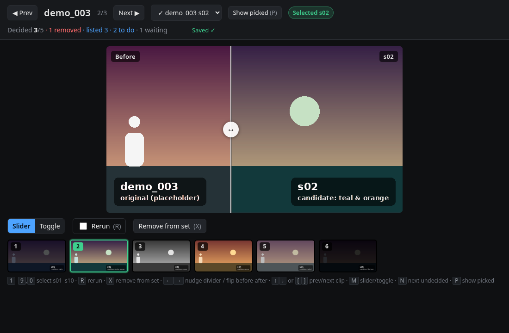
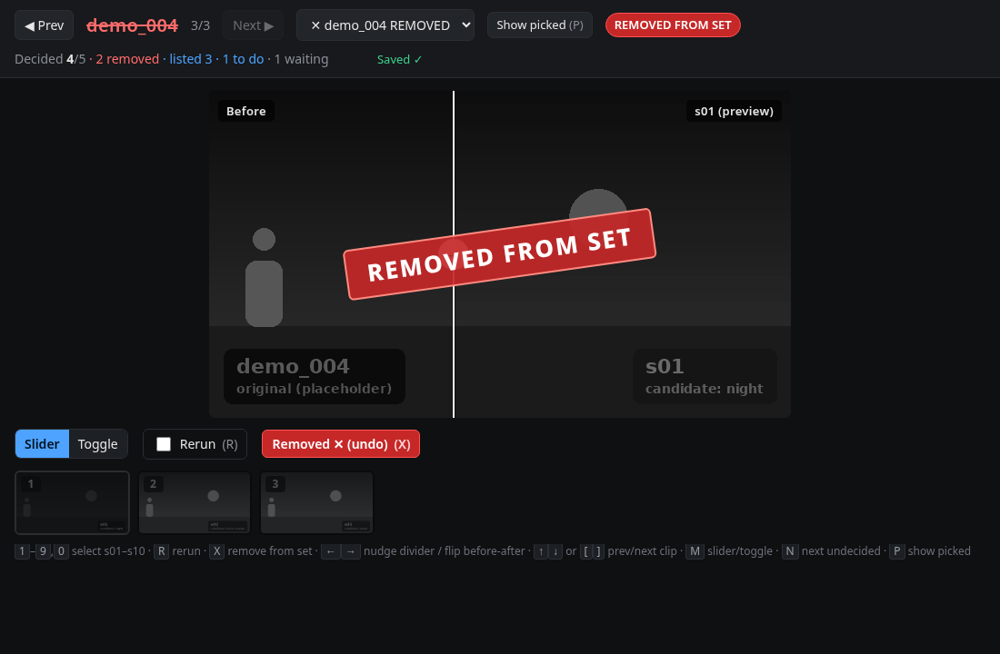
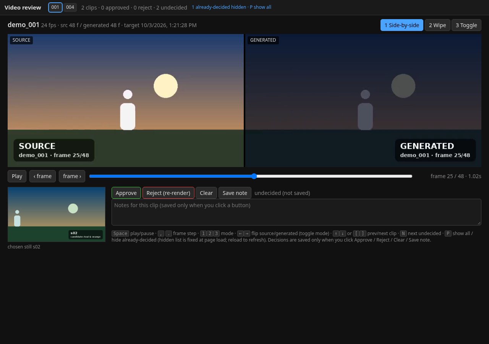
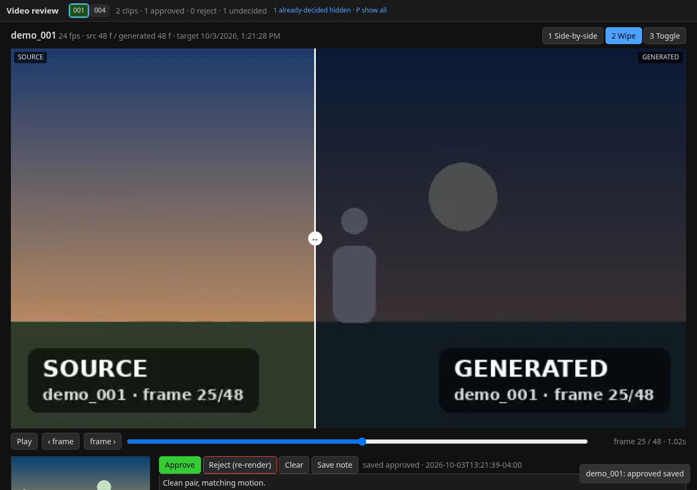
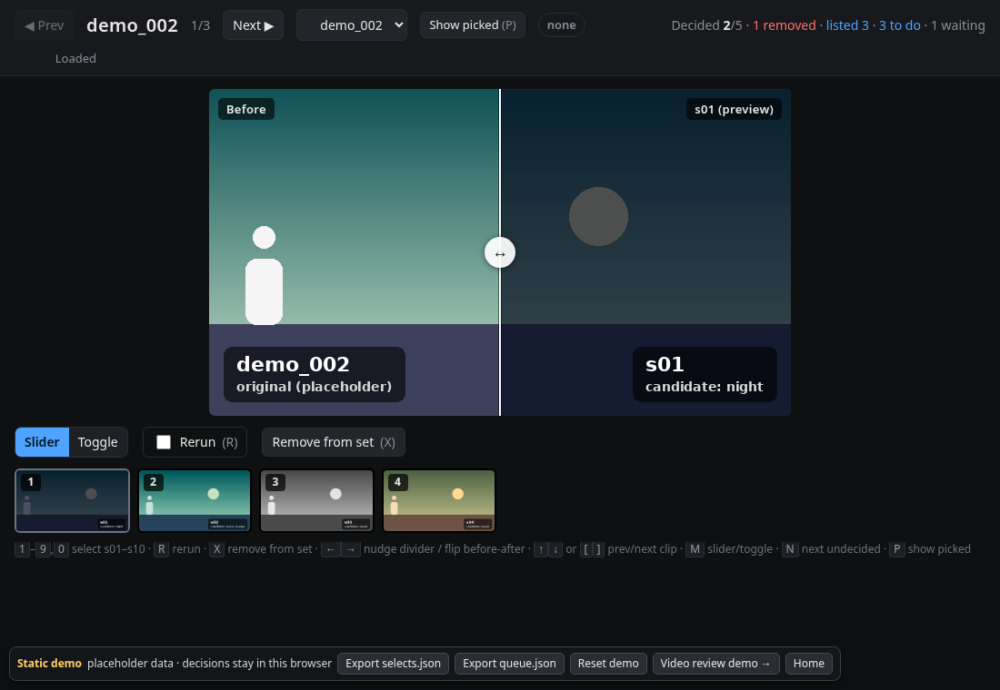

# LoRA dataset review

Two tiny, dependency-free local web apps for **human-in-the-loop LoRA / IC-LoRA dataset building**
(ComfyUI, Magnific, LTX 2.3 ref video-to-video via fal, or any image/video generator):

1. **Stills review**: for each source clip, pick the best AI-generated "look" still (or ask for a rerun,
   or drop the clip from the set).
2. **Video review**: compare each source clip with its generated video, frame-locked, and approve or
   reject the pair for training.

Each app is a single `server.py` (Python 3.8+ standard library only) plus a single `index.html`
(no build step, no CDN). Decisions go to plain JSON files that the next pipeline step reads.

**[Live demo](https://cfryant.github.io/lora-dataset-review/)**: static version of both apps with placeholder
data. Runs fully in your browser; decisions stay in localStorage and export as JSON.

```
source clips ──► candidate stills ──► [1 Stills review] ──► selects.json ──► video model renders
                                                                                    │
            training pairs ◄── tools/export_approved.py ◄── video_selects.json ◄── [2 Video review]
```

---

## Quick start

```bash
python stills_review/server.py --demo      # http://127.0.0.1:8765/  (placeholder data)
python video_review/server.py  --demo      # http://127.0.0.1:8766/  (placeholder data)
python tests/smoke_test.py                 # end-to-end check of both apps (39 checks)
```

`--demo` serves a writable copy of `sample_data/` in `.demo_run/` (gitignored), so the repo itself is never
modified. Add `--demo-reset` to start again from the pristine samples.

With real data:

```bash
python stills_review/server.py --stills /path/to/stills
python video_review/server.py  --out /path/to/video_out --stills /path/to/stills
# or put both apps' settings in one file (see config.example.json):
python stills_review/server.py --config config.json
python video_review/server.py  --config config.json
```

Windows, as a hidden background process (no console window left open):

```powershell
powershell -NoProfile -ExecutionPolicy Bypass -File scripts\start_review.ps1 -App stills -ServerArgs '--stills','D:\lora\stills'
powershell -NoProfile -ExecutionPolicy Bypass -File scripts\start_review.ps1 -App video  -ServerArgs '--config','D:\lora\config.json'
powershell -NoProfile -ExecutionPolicy Bypass -File scripts\start_review.ps1 -App video -Stop
```

Settings precedence: **CLI flag > environment variable > config file > default**. Both servers bind
`127.0.0.1` by default. They have **no authentication**, so keep them on localhost or a trusted LAN.

| Setting | Stills flag / env | Video flag / env | Default |
|---|---|---|---|
| Data folder | `--stills` / `STILLS_REVIEW_DIR` | `--out` / `VIDEO_REVIEW_OUT` | (required) |
| Round filter | `--round` / `STILLS_REVIEW_ROUND` | | `<stills>/round.json` |
| Stills (thumbnail) | | `--stills` / `VIDEO_REVIEW_STILLS` | none |
| Generated clips | | `--targets` / `VIDEO_REVIEW_TARGETS` | `<out>/targets` |
| Source clips | | `--sources` / `VIDEO_REVIEW_SOURCES` | `<out>/pairs` |
| Decision file | (fixed) `<stills>/selects.json` | `--selects` / `VIDEO_REVIEW_SELECTS` | `<out>/video_selects.json` |
| Still override map | | `--chosen-stills` / `VIDEO_REVIEW_CHOSEN_STILLS` | `<out>/chosen_stills.json` |
| Clip-id regex | | `--clip-id-regex` / `VIDEO_REVIEW_CLIP_ID_REGEX` | `^([A-Za-z][A-Za-z0-9]*_\d{3})` |
| Host / port | `--host --port` / `STILLS_REVIEW_HOST/PORT` | `--host --port` / `VIDEO_REVIEW_HOST/PORT` | `127.0.0.1`, 8765 / 8766 |

---

## 1 · Stills review (`stills_review/`)



Shows the clip's original frame ("Before") against one candidate in a drag slider (or click-to-toggle
mode), plus a thumbnail strip of every candidate. Pick one, mark **Rerun** if none is good enough, or
**Remove from set** to drop the clip entirely.



**Expected folder layout**

```
stills/
├── clip_001/
│   ├── clip_001_original.png     source frame ("Before")
│   ├── clip_001_s01.png          candidate 1 (two-digit index, up to s99)
│   └── clip_001_s02.png ...
├── clip_002/ ...
├── selects.json                  written by the app
└── round.json                    optional review-round filter
```

Clip folder names: `[A-Za-z0-9_-]{1,64}`. A folder shows up once it has `_original.png` **and** at least one
`_sNN.png`; until then it is listed as *waiting*. The list is re-scanned every 30 s, so you can start reviewing
while generations are still landing.

**Output: `stills/selects.json`**

```json
{
  "clip_001": {"select": 2,    "rerun": false, "updated": "2026-10-03T13:00:00-04:00"},
  "clip_002": {"select": null, "rerun": true,  "updated": "2026-10-03T13:00:05-04:00"},
  "clip_003": {"select": 4,    "rerun": false, "updated": "2026-10-03T13:00:09-04:00", "removed": true}
}
```

* `select`: chosen candidate number (`clip_001_s02.png`) or `null`.
* `rerun`: candidates should be regenerated (an earlier `select` is kept but ignored).
* `removed`: present only while true. **Removed clips must never go to the next step**, even with a `select`.

The ready-made hand-off list is `GET /api/redo_queue` (aliases `/api/queue` and the legacy `/api/aleph_queue`), or offline
`python tools/export_approved.py stills --stills DIR`:

```json
{"round": "round-2",
 "queue": [{"clip": "clip_001", "select": 2, "still": "clip_001_s02.png"}],
 "removed_skipped": ["clip_003"], "rerun": ["clip_002"], "unpicked": [], "rule": "removed clips are never sent to the next step"}
```

**Rounds (`round.json`, optional).** Limits the page and queue to a subset, e.g. the clips you just regenerated:

```json
{"round": "round-2", "clips": ["clip_002", "clip_007"], "round_start_hidden": ["clip_007"]}
```

`round_start_hidden` is a fixed snapshot of clips already decided **before** this round. Only those are hidden
(press **P** to show them). Picks made during the round stay listed, so the list never jumps while you work.
Without it, the page freezes the "already decided" set when it loads.

**Keyboard shortcuts**

| Key | Action |
|---|---|
| `1`–`9`, `0` | pick candidate s01–s09, s10 |
| `R` | toggle Rerun |
| `X` | toggle Remove from set |
| `←` `→` | nudge slider (Shift = bigger step) / flip before-after in toggle mode |
| `↑` `↓` or `[` `]` | previous / next clip |
| `N` | next clip that still needs a decision |
| `P` | show / hide clips picked before this round |
| `M` | slider ↔ toggle mode |
| `Home` / `End` | first / last clip |

Decisions are saved **only** after a real click or key press. Opening, reloading or navigating never writes.

---

## 2 · Video review (`video_review/`)



Plays the source clip and the generated clip in lock-step (the source is the master clock). Modes:
side-by-side, wipe (drag the divider) and toggle. Shows fps and frame counts parsed straight from the MP4
header (no ffprobe needed), **warns on frame-count mismatch**, and shows the still chosen in app 1.



**Expected folder layout**

```
video_out/
├── targets/clip_001.mp4          generated clip            (--targets to override)
├── pairs/clip_001_src.mp4        frame-aligned source clip (--sources to override)
├── video_selects.json            written by the app
└── chosen_stills.json            optional {"clip_001": 3}: which still to show (else stills/selects.json)
```

A target is paired with `pairs/<same stem>_src.mp4`. The **clip id** (the key in `video_selects.json`) is
group 1 of `--clip-id-regex` applied to the stem, so `clip_001_take2.mp4` → `clip_001`. Targets without a
source are listed as *incomplete*. The server supports HTTP Range requests, so seeking is instant.

**Output: `video_out/video_selects.json`**

```json
{
  "clip_001": {"status": "approved", "note": "",               "updated": "2026-10-03T13:05:00-04:00"},
  "clip_002": {"status": "reject",   "note": "flicker at f40", "updated": "2026-10-03T13:05:30-04:00"},
  "clip_004": {"status": null,       "note": "",               "updated": "2026-10-03T13:06:00-04:00"}
}
```

**Stale rule:** a decision older than the target file's modification time belongs to a previous render (the
clip was re-rendered) and counts as undecided again. On each page load, clips already decided for their
current render are hidden (press **P** to show all).

Collect approved pairs (skips stale decisions):

```bash
python tools/export_approved.py videos --out /path/to/video_out                     # JSON report
python tools/export_approved.py videos --out /path/to/video_out --copy-to dataset \
       --control-suffix _start --target-suffix _end                                 # copy + manifest.json
```

**Keyboard shortcuts**

| Key | Action |
|---|---|
| `Space` | play / pause both |
| `,` `.` | step one frame back / forward |
| `1` `2` `3` | side-by-side / wipe / toggle |
| `←` `→` | flip source ↔ generated (switches to toggle mode) |
| `↑` `↓` or `[` `]` | previous / next clip |
| `N` | next undecided clip |
| `P` | show all / hide clips decided before this page load |

Approve / Reject / Clear / Save note are buttons on purpose: decisions are saved **only** when one is clicked.

---

## Repository layout

```
stills_review/server.py, index.html   app 1 (stdlib server + single-file UI)
video_review/server.py,  index.html   app 2
tools/export_approved.py              read results offline; copy approved pairs into a dataset folder
tools/make_sample_data.py             regenerate placeholder sample_data/ (needs Pillow + ffmpeg)
tools/build_pages.py                  rebuild the static demo in docs/ from the app pages
tests/smoke_test.py                   end-to-end test of both servers + export tool
scripts/start_review.ps1              Windows hidden background launcher
sample_data/                          synthetic placeholder stills + 2 s clips (no real media)
docs/                                 GitHub Pages demo (index.html, assets/demo-shim.js, stills/, video/, screenshots/)
config.example.json                   one config file for both apps
AGENTS.md                             short instructions for AI assistants
```

**Static demo / GitHub Pages.** `docs/stills/` and `docs/video/` are the real `index.html` files plus
`docs/assets/demo-shim.js` (demo-only), which answers the `api/*` requests from `manifest.json` +
localStorage and adds Export / Reset buttons. To publish: *Settings → Pages → Deploy from a branch → `main`
/ `docs`*. After editing an app's `index.html`, run `python tools/build_pages.py` and commit.



---

## For assistants

You are helping a user build a LoRA / IC-LoRA training set (often in a ComfyUI workflow). These apps
are the human approval gates. Follow these steps:

1. **Check the pipeline stage.** Use the stills app after candidate stills exist and before you spend money on
   video renders. Use the video app after renders exist and before you package the dataset.
2. **Arrange the files** on the machine that holds the media (the servers read local files only):
   * Stills: `stills/<clip>/<clip>_original.png` + `<clip>_s01.png …`. Rename ComfyUI outputs such as
     `ComfyUI_00012_.png` to this pattern, and extract the source frame (for example
     `ffmpeg -i clip.mp4 -frames:v 1 <clip>_original.png`).
   * Video: `video_out/targets/<stem>.mp4` (generated) + `video_out/pairs/<stem>_src.mp4` (source trimmed or
     conformed to the **same frame count, fps and start frame**). Clip ids must match `--clip-id-regex`.
     The default is `name_123`. Pass your own regex if the names differ.
3. **Start the server.** Use `python stills_review/server.py --stills DIR` or `python video_review/server.py
   --out DIR --stills DIR`. On Windows, `scripts/start_review.ps1` runs it hidden. Check that
   `GET /api/clips` lists the expected clips, then **give the user the URL** (`http://127.0.0.1:8765/` or
   `:8766/`) and the key shortcuts above. If the server runs on a remote box, the user needs a tunnel or must
   run it locally. Never bind `0.0.0.0` on an untrusted network.
4. **Do not touch the JSON files while the user is reviewing.** Wait until they say they are done.
5. **Read the results:**
   * Stills: `GET /api/redo_queue` or `tools/export_approved.py stills`. Send **only** `queue` items to the
     video model, using `still` as the reference image. Regenerate candidates for `rerun` clips, then start a new
     round with `round.json` (`clips` = the regenerated ids, `round_start_hidden` = []). **Never** use
     `removed_skipped` clips.
   * Video: `tools/export_approved.py videos --out DIR`. Use `approved` pairs for training. Re-render `reject` (list: video `GET /api/redo_queue`)
     clips with LTX 2.3 ref video-to-video via fal, and read the user's `note` for what to fix. When a new render overwrites the target, its old
     decision becomes stale, so the clip reappears for review automatically.
6. **Package the dataset** with `--copy-to DATASET --control-suffix … --target-suffix …` (for example
   `_start`/`_end` for fal's LTX IC-LoRA trainer), add captions as your trainer requires, and confirm the
   frame counts match.
7. **Report back** with counts (approved / rejected / stale / undecided) and the paths you used. Do not
   paste the JSON unless asked.

Safety notes: both servers only read inside the configured folders (path-checked) and only write their own
decision file (atomic temp-file + rename). They have no auth. Keep personal paths in `config.json` (gitignored),
not in the code.

## License

MIT, see [LICENSE](LICENSE).
